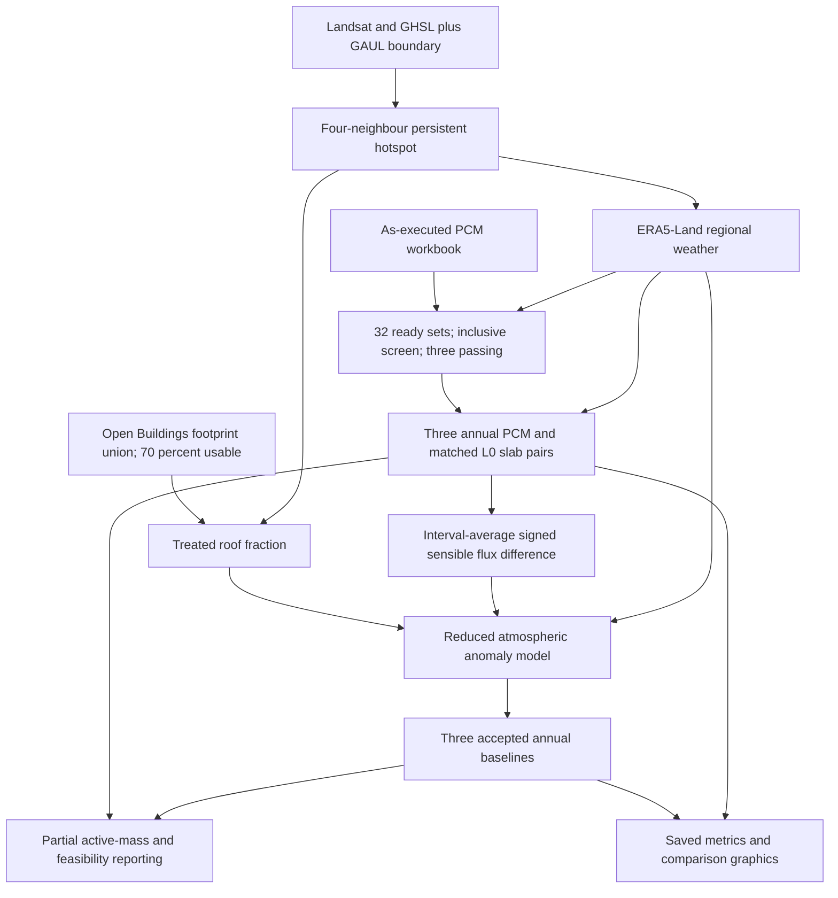

# Research workflow and inspection order

The accepted scientific chain is:

There is no return arrow to the roof model: coupling is one-way. Full Category 2 is absent. The exploratory illustrations sit outside the verified numerical chain because exact generators/exports are missing.

1. Read [README](../README.md), [methods](methodology.md) and [assumptions](model_assumptions.md).
2. Inspect [input locations](../configs/input_locations.json) and [data availability](../DATA_AVAILABILITY.md). Paths record local scientific requirements; excluded inputs are explained there.
3. Inspect [screening](../results/postprocessing/baseline_graphs/candidate_screen_audit.csv), [hotspot qualification/ranking](../results/preliminary/hotspot_region_audit.csv) and [selected geometry](../manifests/preliminary/hotspot_summary.json).
4. Inspect [Category 1](../results/category1): pcm_001/002/003 correspond to PCM-011/067/069; each has paired hourly outputs and depth states.
5. Follow each `delta_H.csv` into [accepted Category 3](../results/category3/accepted_baselines). Experiment identity, hourly_statistics.csv, numerical_convergence.csv and spatial_diagnostics.npz define the saved case.
6. Compare [derived tables](../results/postprocessing) with [figure provenance](../PAPER_FIGURE_INDEX.md) and [saved findings](../results/validation/verified_findings.json).
7. Run only the lightweight checks in [reproducibility](../REPRODUCIBILITY.md) during ordinary inspection.

A future deliberate computation would run `run_preliminary()`, `run_rooftop()`, then `run_atmospheric_baselines()` in the same Python process. These functions use in-memory handoffs, authorized Earth Engine access, restored exact workbook and new outputs. Merely copying saved files into a runtime directory does not construct that handoff. Fresh annual orchestration remains untested.

The three saved baseline cases carry numerical acceptance within their documented scope. The wider uncertainty/feedback ensemble and deployment assessment remain incomplete. `candidate_population_final=false`, `CATEGORY3_READY=false` and `CATEGORY4_READY=false` must not be interpreted as completed wider scientific validation.
